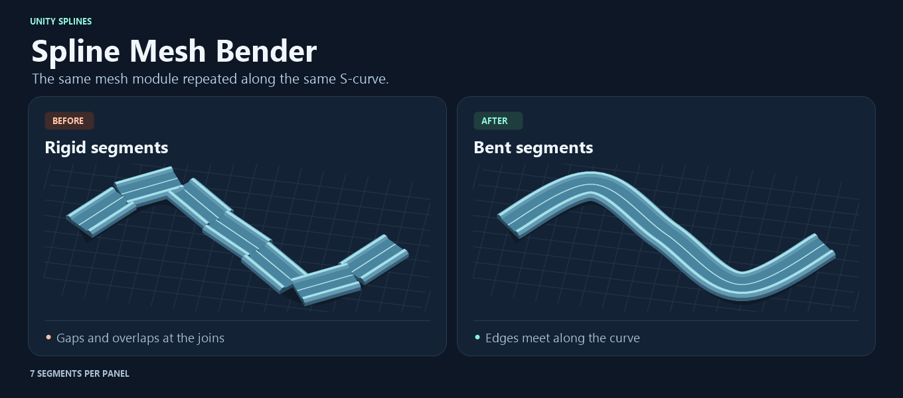

# Spline Mesh Bender

The **Spline Mesh Bender** component fills every spline on its GameObject's `SplineContainer` with copies of a source segment. It adjusts segment length so a whole number of copies fit the spline and combines the result into chunk meshes.



## Install

In Unity 6.3, open **Window > Package Management > Package Manager**, choose **Install package from git URL**, and enter the following URL.

```text
https://github.com/schyro/unity-spline-mesh-bender.git#v0.1.0
```

## Set up a segment

1. Add **Splines > Spline Mesh Bender** to a GameObject and draw a spline with at least two knots on its `SplineContainer`.
2. Assign a model or prefab in **Segment**. The component uses the first `MeshFilter` with a mesh whose GameObject name does not start with `COL_`. It copies the materials from the `MeshRenderer` on that same object.
3. Model the segment along local **+Z**, with **+Y** up and **X = 0** at the center. Apply transforms to the source mesh before export. The bender uses mesh vertices directly. Enable **Read/Write** on imported meshes and add subdivisions along Z where the mesh needs to follow tight curves.
4. For collision, enable **Generate Colliders** and add a child named `COL_...` with a `MeshCollider` and a readable triangle mesh. Use the same local coordinates and longitudinal bounds as the visual mesh.

The component rebuilds as you edit splines or Inspector settings. **Offset** shifts geometry in the bent frame. **Segments Per Chunk** sets how many copies share one mesh. **Sample Step** controls spline sampling in local units. The frame uses world up as its reference. Knot roll does not bank the result.

Generated objects and meshes are transient. At runtime, after changing the spline, call `Rebuild()` on the component to regenerate the output. The component type is `Schyro.SplineMeshBender.SplineMeshBender`.

[MIT License](LICENSE.md)
